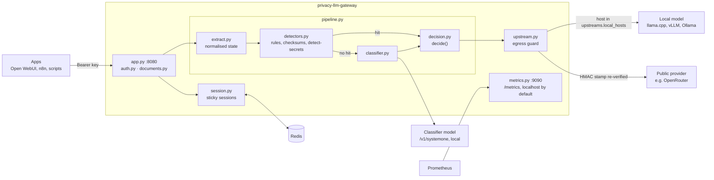

# privacy-llm-gateway

[](https://github.com/dkruyt/privacy-llm-gateway/actions/workflows/ci.yml)
[](LICENSE)


A privacy-aware, OpenAI-compatible LLM gateway. It decides, per request, whether a
prompt may go to a cloud LLM or must stay on your own hardware.

Cloud models are often better and cheaper to run than local ones, but much of what people
paste into a chat should never leave the organisation: customer records, passwords and API
keys, contracts, internal documents, source code. Users don't reliably make that call
themselves. privacy-llm-gateway makes it for them: every app talks to one endpoint, and
every request is **checked on this machine** before anything leaves it.

## What the privacy check looks for

Each request with model `auto` goes through two checks, both running locally:

1. **Detectors** (fast, rule-based) look for content that should never go to a public LLM:
    - personal data: e-mail addresses, phone numbers, IBANs, credit card numbers (Luhn-checked),
      Dutch BSN numbers, private IP addresses;
    - secrets: private keys, cloud and SaaS tokens (AWS, GitHub, OpenAI-style, Slack, Google,
      Stripe), JWTs, bearer tokens, `password = ...` assignments, URLs with credentials, plus
      [detect-secrets](https://github.com/Yelp/detect-secrets);
    - organisation markers: your internal domains and phrases like "confidential" or
      "internal use only";
    - attempts to talk the classifier into calling something public.

    Detectors also look inside base64 and URL-encoded text. Any hit routes the request local.
2. **A local classifier model** reads the whole conversation (including attached PDFs and text
   files) and scores it against categories you define in the config: by default personal data,
   credentials, private documents, confidential business information and proprietary code.
   The request goes public only if the model is confident it is public **and** every category
   scores low.

| Result of the check | Route |
|---|---|
| sensitive or uncertain | **local** model (llama.cpp / vLLM / Ollama, OpenAI-compatible) |
| confidently public: every check agrees | **public** provider (OpenAI-compatible, e.g. OpenRouter) |
| any failure anywhere | **local** |

A failing local model returns an error to the client. **No code path retries on, or
falls back to, the public provider.** Once a conversation is found sensitive, it stays local
(sticky sessions). Model `local` always goes local and skips classification. Clients can
never choose the public provider or its model.

It is a single headless Python service: no UI, no database, no admin API. One YAML
file defines all behaviour. Observability comes from Prometheus `/metrics` and JSON logs.
It does not use LiteLLM or any other gateway/proxy library.

## Use cases

- **A company chat assistant.** Staff use Open WebUI (included in the compose stack) for
  everything. General questions get a strong cloud model; the moment someone pastes a
  customer e-mail, an HR case or a contract, that conversation moves to the in-house model.
- **Automations that handle mixed data.** n8n flows, scripts or ticket bots send summaries,
  translations and classifications through one endpoint. Tickets that contain personal data
  or credentials are processed locally; the rest use the cheaper or better cloud model.
- **Developer tools and coding assistants.** Generic programming questions go to the cloud;
  prompts with internal code, config files, hostnames or a leaked API key stay local.
- **Regulated work (GDPR, healthcare, legal, finance).** Use cloud LLMs where that is allowed,
  with a technical guarantee, not just a policy, that personal data is not sent to them, and
  metrics that show how much traffic went where.
- **Getting the most out of a small local GPU.** Send only what has to stay private to the
  local model, and let the cloud handle the rest.

---

## Contents

- [Architecture](#architecture)
- [Request flow](#request-flow)
- [Quick start](#quick-start)
- [Configuration reference](#configuration-reference)
- [HTTP API](#http-api)
- [Reason codes](#reason-codes)
- [Metrics reference](#metrics-reference)
- [Logs](#logs)
- [Operations](#operations)
- [Testing](#testing)
- [Troubleshooting](#troubleshooting)
- [Limits and non-goals](#limits-and-non-goals)
- [Opaque reasoning](#opaque-reasoning)
- [Security model](#security-model)
- [Design decisions](#design-decisions)

---

## Architecture



| Module | Responsibility |
|---|---|
| `__main__.py` | CLI: `serve`, `check-config`, `calibrate`. Single process, or a pre-fork supervisor for `workers > 1`. |
| `config.py` | YAML + pydantic schema (`extra="forbid"`), secret resolution, SIGHUP reload with atomic swap. |
| `app.py` | FastAPI routes, request handling, OpenAI-style errors, lifespan, 30 s dependency probe. |
| `metrics.py` | Dedicated Prometheus registry, fixed label sets, the `/metrics` ASGI app. |
| `auth.py` | Bearer key → key id (constant-time comparison of SHA-256). |
| `schemas.py` | Accepted request shapes (extra fields kept), routing-field blocklist. |
| `extract.py` | Request → normalised classifier state, all strings, unsupported flags, session seed. |
| `detectors.py` | Rule-id-only detectors (regex + checksums + detect-secrets) on raw and decoded text. |
| `classifier.py` | `/v1/systemone` client, question builder, strict response validation. |
| `decision.py` | Pure `decide()`. 100 % branch-covered. |
| `documents.py` | PDF / text attachments → text parts (pypdf in a worker thread). |
| `session.py` | Redis sticky-session store, fail-closed; also the prefix-cache reads and writes. |
| `prefix_cache.py` | Prefix-cache key chain (HMAC), policy fingerprint, "clearly public" check. |
| `pipeline.py` | `evaluate()`: extract → detectors → short-circuit → [prefix cache] → classifier → decide. |
| `upstream.py` | Two `httpx.AsyncClient`s (`trust_env=False`, no redirects, no retries). Egress guard. |
| `logs.py` | Content-free JSON logger, one decision line per request. |
| `calibrate.py` | Labelled JSONL → classifier → threshold sweep. |

There are only three outbound destinations: the classifier, the local upstream and the public
upstream. A unit test fails if any module other than `upstream.py` or `classifier.py`
imports an HTTP client library. There is no telemetry.

## Request flow

1. **Authenticate** the `Authorization: Bearer <key>` header against the configured SHA-256 hashes. The result is a `key_id`; failure returns 401. Enforce `server.request_max_bytes` (413).
2. **Reject routing fields** sent by the client with 400: `api_base`, `base_url`, `api_key`, `custom_llm_provider`, `api_version`, `fallbacks`, `provider`, `route`.
3. **`model == "local"`** routes local without classification. Any other model name, including `gpt-4o` or `openrouter/...`, is classified like `auto`.
4. **Convert attachments** (PDF and text files) to text parts. Scanned, encrypted, broken or unsupported documents are rejected with 400.
    - **Remove opaque reasoning**: `reasoning_details` items of type `reasoning.encrypted` and `signature` fields, which clients replay on follow-up turns (OpenRouter format). See [Opaque reasoning](#opaque-reasoning).
5. **Sticky session**: if the session is flagged sensitive, route local (`session_sticky`). If Redis is unreachable, route local (`session_store_unavailable`) without pinning.
6. **`pipeline.evaluate()`** runs. **Any** exception routes local (`classifier_internal_error`).
    - The extracted state is the *complete* request: every role, tool calls, tool results, tool schemas, `response_format`, `prompt`, `user` and unknown extra fields. Strings are NFKC-normalised and stripped of zero-width and bidi control characters.
    - Detectors run on every string, plus its base64- and %-decoded variants. Any hit routes local and pins the session, and the classifier is skipped.
    - Documents (unless `documents.allow_public`), unsupported media and oversize states also skip the classifier.
    - **Prefix cache** (`policy.session.prefix_cache.enabled`, off by default): see [Prefix cache](#prefix-cache). On a hit only the new messages are classified.
    - The classifier answers `verdict` (choice over the categories), `has_<category>` (noul) and `manipulation` (noul). The response is validated strictly.
    - `decide()` returns public only if no reason exists at all and all four thresholds pass.
7. **Pin**: if `decision.sticky`, the session flag is set with a TTL.
8. **Build the outbound body**: copy the request, set `model` from config, drop gateway-only fields. Messages are never touched after classification.
9. **Stamp** = `HMAC-SHA256(key, f"{route}|{sha256(canonical_json(body without model))}")`.
10. **`upstream.send()`**:
    - public route: the HMAC is recomputed over exactly the body being sent.
    - local route: the target host must be in `upstreams.local_hosts`.
    - Streaming passes SSE through unchanged; headers go out before the first byte, and the upstream is closed if the client disconnects.
11. Classification always completes before an upstream connection opens, for streaming requests too (tested).

Response headers on every routed request: `x-privacy-route`, `x-privacy-verdict` and
`x-privacy-reasons` (comma-separated codes only).

## Quick start

```bash
cp config.example.yaml config.yaml
```

Then edit `config.yaml`:

- Set `upstreams.*`, `classifier`, `redis` and `auth.keys`. The public upstream must use
  `https://`; plain `http://` to the local model or classifier is only accepted for loopback,
  private IPs and single-label hosts (see `upstreams.allow_insecure_http`).
- For Docker Compose:
  - `server.metrics_listen: 0.0.0.0:9090` (compose only publishes it on 127.0.0.1)
  - `redis.url: redis://redis:6379/0` and `redis.password: "${REDIS_PASSWORD}"`

For Docker Compose, also create `.env` and fill it in. Compose refuses to start while
`REDIS_PASSWORD`, `OPENWEBUI_GATEWAY_KEY`, `WEBUI_SECRET_KEY` or `GRAFANA_ADMIN_PASSWORD`
is empty:

```bash
cp .env.example .env
```

Create an API key for a client app and its hash for `auth.keys`:

```bash
python3 -c 'import secrets,hashlib;k=secrets.token_urlsafe(32);print("key:",k);print("sha256:",hashlib.sha256(k.encode()).hexdigest())'
```

Validate the config. Secrets must be present in the environment, or as files when the config uses `{file: ...}`.
The `privacy-llm-gateway` command comes from installing the package (see *locally* below); in Docker, run it
with `docker compose run --rm --no-deps gateway check-config --config /etc/privacy-llm-gateway/config.yaml`:

```bash
LOCAL_KEY=... PUBLIC_KEY=... CLASSIFIER_KEY=... privacy-llm-gateway check-config --config config.yaml
```

Run it with Docker (the keys come from `.env`):

```bash
docker compose up -d --build
```

The gateway (port 8080) and Open WebUI (port 3000) listen on 127.0.0.1 unless you set
`BIND_ADDR` in `.env`. Put a TLS reverse proxy in front before exposing them.

Or locally (Python 3.12). The lock files are resolved for linux/x86_64; if hash checking
fails on your platform, use `pip install -e .` instead:

```bash
pip install --require-hashes -r requirements.lock && pip install --no-deps -e .
```

```bash
privacy-llm-gateway serve --config config.yaml
```

Point clients at `http://<host>:8080/v1` with model `auto` (or `local`).

## Configuration reference

The fully commented reference is [`config.example.yaml`](config.example.yaml). Summary:

| Key | Default | Notes |
|---|---|---|
| `server.listen` | `0.0.0.0:8080` | API listener. **Restart required.** |
| `server.metrics_listen` | `127.0.0.1:9090` | `/metrics` only. **Restart required.** |
| `server.metrics_auth_token` | `null` | Optional bearer token for `/metrics` (secret). |
| `server.workers` | `1` | `>1` needs `stamp.key_file`; Prometheus multiprocess mode. **Restart required.** |
| `server.request_max_bytes` | `30000000` | Larger bodies → 413. |
| `auth.keys[]` | — | `{id, sha256}`; `id` is the only client label in metrics/logs. |
| `upstreams.local` | — | `base_url`, `model`, `api_key` (secret/null), `timeout_s`, `passthrough_paths` (default `[]`). |
| `upstreams.public` | — | `base_url` (must be `https://`), `model`, `api_key`, `timeout_s`. Host must not be in `local_hosts`. |
| `upstreams.local_hosts` | — | Egress allowlist for the local route **and the classifier**. |
| `upstreams.allow_insecure_http` | `false` | `true` allows plain `http://` to the public upstream and to non-private local hosts. Tests or trusted networks only. |
| `classifier` | — | `url`, `model`, `api_key`, `timeout_s` (30), `max_state_chars` (32000). Host must be in `local_hosts`. |
| `redis` | — | `url` (no credentials), `password` (secret/null), `connect_timeout_s` (0.5), `timeout_s` (0.5). |
| `stamp.key_file` | `null` | HMAC key file (≥ 32 bytes); `null` = random per process. |
| `policy.thresholds` | 0.80 / 0.60 / 0.30 / 0.30 | `public_min_prob`, `min_confidence`, `category_max_prob`, `manipulation_max_prob`. **Not calibrated.** |
| `policy.session` | 86400 / `x-session-id` / true | `ttl_seconds`, `header`, `sticky_on_uncertain`. |
| `policy.session.prefix_cache` | false / 0.10 / 86400 | `enabled`, `borderline_margin` (0–0.5), `ttl_seconds`. See [Prefix cache](#prefix-cache). |
| `policy.documents` | false / 25 MiB / 300 / 20 | `allow_public`, `max_bytes`, `max_pages`, `min_text_chars`. |
| `policy.state_notice`, `verdict_instructions`, `manipulation_instructions` | built-in | Text sent to the classifier. |
| `policy.categories` | — | `public` and `uncertain` (description only) plus ≥ 1 sensitive category (`description` + `question`). |
| `policy.detectors` | — | `disabled`, `internal_domains`, `confidential_markers`, `manipulation_patterns`, `custom_patterns`, `national_phone_patterns`, `detect_secrets.{enabled,plugins}`. |
| `logging` | INFO / json | `level`, `format` (json only). |

**Secrets** are never written in the YAML. A secret field accepts only `"${ENV_VAR}"`,
`{file: /run/secrets/x}` or `null`. A literal value is a config error, and an unset
variable or missing file fails startup. All validation errors print the field path
and exit with status 2. The gateway never starts half-configured.

**Reload** with `kill -HUP <pid>` (or `docker compose kill -s HUP gateway`):

- The file is re-read and validated in full, the derived runtime (detectors, HTTP clients, Redis client) is rebuilt, and the swap is atomic.
- If validation fails, the old config stays active, `config_reload result=failed` is logged and `privacy_config_reloads_total{result="failed"}` is incremented.
- In-flight requests finish on the config they started with. The old clients are closed after the longest upstream timeout.
- Changes to `server.listen`, `server.metrics_listen` and `server.workers` are **not** applied on reload. They are logged as `restart_required_for` and need a restart.

## HTTP API

| Method / path | Auth | Behaviour |
|---|---|---|
| `POST /v1/chat/completions` | Bearer | Classified (`auto`/any) or local (`local`); `stream` true/false. |
| `POST /v1/completions` | Bearer | Same; token-id prompts are flagged `unsupported:token_ids`. |
| `GET /v1/models` | Bearer | Returns only `auto` and `local`. |
| other `/v1/*` | Bearer | `auto`/other model → 400 `endpoint_requires_local`; `local` → proxied only if listed in `upstreams.local.passthrough_paths`, else 404. |
| `GET /healthz` | none | Process up. |
| `GET /readyz` | none | 200 when config is loaded and Redis is reachable; reports classifier status (not required). |
| `GET /metrics` | none / token | **Only on `server.metrics_listen`.** |

Errors use the OpenAI shape `{"error": {"message", "type", "code"}}`. Error codes include:

- 401 `invalid_api_key`
- 400 `invalid_json`, `invalid_request`, `routing_field_not_allowed`, `endpoint_requires_local`
- 400 document errors: `pdf_encrypted`, `pdf_unreadable`, `pdf_no_text_layer`, `text_not_utf8`, `unsupported_document_type`, `document_invalid_base64`
- 413 `request_too_large`, `document_too_large`
- 404 `not_found`
- 502 `upstream_http_4xx`, `upstream_http_5xx`, `upstream_transport`
- 504 `upstream_timeout`
- 500 `egress_blocked`, `internal_error`

Validation errors list field paths only and never echo input values.

## Reason codes

| Code | Verdict | Pinned | Meaning |
|---|---|---|---|
| `detector:<rule>` | sensitive | yes | A detector fired (classifier skipped). Rules below. |
| `unsupported:media:image\|audio\|file` | uncertain | if `sticky_on_uncertain` | Non-text part (not a converted document). |
| `unsupported:data_url` | uncertain | if `sticky_on_uncertain` | A `data:` URL remained after document conversion. |
| `unsupported:unknown_part_type` | uncertain | if `sticky_on_uncertain` | Unrecognised content part type. |
| `unsupported:token_ids` | uncertain | if `sticky_on_uncertain` | Completion prompt given as token ids. |
| `too_large_for_classifier` | uncertain | **no** | State > `classifier.max_state_chars` (never truncated). |
| `classifier_error:<code>` | uncertain | **no** | `timeout`, `transport_error`, `http_<status>`, `invalid_json`, `missing_answers`, `missing_verdict`, `missing_category`, `missing_manipulation`, `unknown_choice`, `invalid_number`, `prob_out_of_range`, `probabilities_not_normalized`, `choice_not_argmax`, `wrong_type`. |
| `classifier_choice:uncertain` | uncertain | if `sticky_on_uncertain` | The classifier chose "uncertain". |
| `classifier_choice:<category>` | sensitive | yes | The classifier chose a sensitive category. |
| `classifier_low_public_prob` | uncertain | if `sticky_on_uncertain` | p(public) < `public_min_prob`. |
| `classifier_low_confidence` | uncertain | if `sticky_on_uncertain` | confidence < `min_confidence`. |
| `classifier_category:<category>` | sensitive | yes | p(has_category) > `category_max_prob`. |
| `classifier_manipulation_score` | sensitive | yes | p(manipulation) > `manipulation_max_prob`. |
| `document_attached:pdf\|text` | sensitive | yes | A converted document (unless `documents.allow_public`). |
| `session_sticky` | sensitive | (already) | The session was flagged earlier; TTL refreshed. |
| `session_store_unavailable` | uncertain | no | Redis unreachable (fail closed). |
| `classifier_internal_error` | uncertain | no | Unexpected exception anywhere in classification. |
| `not_classified` | uncertain | no | Defensive; should never occur. |

Requests with model `local` carry verdict `uncertain` and no reasons, because they are never classified.

**Detector rules**:

- Personal data: `email`, `phone_intl`, `phone_nl` (configurable national set), `iban` (exact length per registry country plus mod-97; not glued to letters, digits, `+` or `=`), `credit_card` (Luhn and a known IIN), `nl_bsn` (11-test, whole token), `private_ip` (RFC 1918 and IPv6 ULA).
- Credentials: `pem_private_key`, `aws_access_key`, `github_token`, `openai_style_key`, `slack_token`, `google_api_key`, `stripe_key`, `jwt`, `bearer_token`, `credential_assignment`, `url_with_credentials`, plus `detect_secrets:<Plugin>` (detect-secrets line scan with its filters).
- Organisation: `internal_domain`, `confidential_marker`, `custom:<id>`.
- Manipulation: `classifier_manipulation`.

Any rule can be disabled with `policy.detectors.disabled`; listing `detect_secrets` there turns off all detect-secrets plugins.

## Metrics reference

Metrics are served by `prometheus_client` from a dedicated registry. Label values come
from fixed sets. The only client label is `key_id`, taken from config. No label ever
holds session ids, prompts, client-chosen model names or free text. Anything outside
the fixed reason set becomes `other`.

| Metric | Type | Labels |
|---|---|---|
| `privacy_requests_total` | counter | `key_id, endpoint, requested=auto\|local, route=local\|public, verdict=public\|sensitive\|uncertain, stream` |
| `privacy_route_reasons_total` | counter | `reason` (codes above) |
| `privacy_classifier_calls_total` | counter | `result=ok\|timeout\|transport_error\|http_error\|invalid` |
| `privacy_classifier_skipped_total` | counter | `why=detector\|unsupported\|too_large\|session\|local_model\|document` |
| `privacy_session_events_total` | counter | `event=hit\|pinned\|store_unavailable\|write_failed` |
| `privacy_prefix_cache_total` | counter | `result=miss\|hit_full\|hit_delta\|borderline\|delta_sensitive\|unavailable\|stored\|store_failed` |
| `privacy_documents_total` | counter | `type=pdf\|text\|other, result=converted\|rejected` |
| `privacy_opaque_reasoning_stripped_total` | counter | none: encrypted reasoning items / signatures removed before classification |
| `privacy_egress_total` | counter | `route, result=allowed\|blocked` (**blocked must stay 0**) |
| `privacy_upstream_errors_total` | counter | `route, kind=http_4xx\|http_5xx\|timeout\|transport` |
| `privacy_client_errors_total` | counter | `code` (400/401/404/413 error codes) |
| `privacy_config_reloads_total` | counter | `result=ok\|failed` |
| `privacy_classification_seconds` | histogram | whole pipeline |
| `privacy_classifier_seconds` | histogram | classifier call |
| `privacy_upstream_ttfb_seconds` | histogram | `route` |
| `privacy_request_seconds` | histogram | `route, stream` |
| `privacy_classifier_p_public`, `privacy_classifier_confidence`, `privacy_classifier_category_max_prob`, `privacy_classifier_manipulation_prob` | histogram | buckets 0.05…1.0, for threshold tuning |
| `privacy_classifier_input_tokens` | histogram | from the classifier's `usage.input_tokens` |
| `privacy_inflight_requests` | gauge | `route` |
| `privacy_config_info` | gauge | `config_sha256` (=1 for the active file) |
| `privacy_build_info` | gauge | `version` |
| `privacy_up` | gauge | `dependency=redis\|classifier\|local` (probe every 30 s; never probes the public upstream) |

The integration invariant is `privacy_egress_total{route="public",result="allowed"}` = the
number of calls the public provider received. Alert rules are in
[`prometheus/alerts.yml`](prometheus/alerts.yml): egress blocked, classifier error ratio > 20 %
for 10 min, Redis down, public share dropped to 0, plus local model down and failed reloads.

## Logs

JSON lines on stdout. Each request produces exactly one `decision` line with these fields:

- `key_id`, `endpoint`, `requested`, `route`, `verdict`, `reasons`, `stream`
- `session`: the last 12 hex characters of the hashed session key
- `session_source`: `header`, `metadata` or `derived`
- `classifier`: choice, p_public, confidence, per-category probabilities, manipulation, input_tokens; with the prefix cache also `mode` (`full`, `delta`, `delta_full`, `cached`) and `prefix_messages` (scores are those of the call that decided)
- `documents`, `status`
- `timings_ms`: detectors, classifier, classification, upstream_ttfb, total

Other events: `startup`, `config_reload`, `client_error`, `document_rejected` (code
only), `session_store_write_failed`, `classifier_internal_error`,
`external_call_allowed` (public calls, with a 16-character body digest),
`blocked_external_call`, `probe_failed` and `internal_error`.

**Never logged:** prompts, responses, filenames, raw session ids, API keys or exception
messages. Exceptions are reduced to their type name. Tracebacks are dropped because
exception text can quote request content. Interpolated arguments of third-party log
records are dropped, and the uvicorn access log is disabled. The detect-secrets logger,
which would print skipped secret values, is silenced.

## Operations

- **Multiple workers** (`server.workers > 1`): the parent binds the API socket, forks workers and serves the aggregated `/metrics` (Prometheus multiprocess mode in `PROMETHEUS_MULTIPROC_DIR`, a temp dir by default). SIGHUP and SIGTERM are forwarded to the workers. If a worker dies, the parent shuts everything down so your supervisor restarts it. `stamp.key_file` is required.
- **Docker**: the image runs as uid 10001, works with `read_only: true` plus a `/tmp` tmpfs, and needs no capabilities. `compose.yml` adds `cap_drop: [ALL]` and `no-new-privileges`. Redis runs without persistence; session flags are ephemeral by design.
- **Secrets in Docker**: pass them as environment variables, or mount files and use `{file: /run/secrets/...}`.
- **Prometheus**: scrape `gateway:9090/metrics`. Keep it off the public network, or set `server.metrics_auth_token`.
- **Rotating API keys**: add the new hash, reload, migrate clients, then remove the old hash and reload again.
- **Calibrating thresholds**: `privacy-llm-gateway calibrate --config config.yaml --input labelled.jsonl [--output scores.jsonl]`.
    - Input lines are `{"label": "public"|"sensitive", "text": "..."}` or `{"label": ..., "request": {...chat body...}}`, as in [`calibration/examples.jsonl`](calibration/examples.jsonl).
    - It prints *leaked* (sensitive → public) and *released* (public → public) for the current config and a sweep of each threshold, for the classifier alone and for the full pipeline.
    - It exits 1 if the current config leaks. `--output` writes scores only, never text.
    - With Docker Compose, run it in the gateway container (the image has no `privacy-llm-gateway` script; the input file is piped in):

      ```bash
      docker exec -i privacy-llm-gateway-gateway-1 sh -c 'cat > /tmp/ex.jsonl && python -m privacy_llm_gateway calibrate --config /etc/privacy-llm-gateway/config.yaml --input /tmp/ex.jsonl' < calibration/examples.jsonl
      ```

### Open WebUI

`docker compose up -d` also starts Open WebUI on http://localhost:3000 (`OPENWEBUI_PORT`). It reaches the
gateway only through the **Privacy LLM Gateway** pipe function ([`openwebui/privacy_llm_gateway_pipe.py`](openwebui/privacy_llm_gateway_pipe.py)).
The pipe offers the models `auto` and `local`, sends each request to the gateway, and shows a status
line above every answer built from the `x-privacy-*` response headers:

| Status | Meaning |
|---|---|
| `🌐 Public model` | `auto`, every check agreed: handled by the public provider |
| `🔒 Local model · sensitive: detector:email` | `auto`, routed local; verdict and reason codes (valve `SHOW_REASONS`) |
| `🔒 Local model (selected)` | model `local` was chosen |

The answer itself is relayed unchanged. The pipe sends the Open WebUI chat id as `x-session-id`
(valve `SEND_CHAT_ID_AS_SESSION`), so sticky pinning follows the chat. Title, tag and follow-up
generation run on `privacy_gateway.local` and show no status.

Install or update the function after the first start, and after every change to the pipe:

```bash
python3 openwebui/install.py --url http://localhost:3000
```

It signs in as admin (env `OPENWEBUI_TOKEN`, or prompts for e-mail and password), creates or updates
the function, disables the direct OpenAI connection, and sets the task and default models. The compose
environment covers these settings only for a fresh Open WebUI database. The gateway key comes from
`PRIVACY_GATEWAY_KEY` (`OPENWEBUI_GATEWAY_KEY` in `.env`), not from the function's valves. Pipe models
without a model entry are visible to admins only: to give users access, open
*Admin Panel → Settings → Models* and set access on `auto` and `local`.

### Monitoring stack (Prometheus + Grafana)

`docker compose up -d` also starts Prometheus and Grafana, both bound to localhost:

| Service | URL | Notes |
|---|---|---|
| Grafana | http://localhost:3001 (`GRAFANA_PORT`) | user `admin`, password `GRAFANA_ADMIN_PASSWORD` from `.env`; the **Privacy LLM Gateway** dashboard is the home dashboard |
| Prometheus | http://localhost:9091 (`PROMETHEUS_PORT`) | scrapes `gateway:9090` every 15 s, 30 days retention, loads `prometheus/alerts.yml` (see *Alerts*) |

Everything is provisioned from files: the datasource from `grafana/provisioning/datasources/`, and the dashboard
from `grafana/dashboards/privacy-llm-gateway.json`, which `python3 grafana/build_dashboard.py` regenerates.
The dashboard is read-only in the UI; change the generator instead. Grafana telemetry, update checks,
the news feed and plugin pre-installs are off. There is no Alertmanager: alerts are visible in the
Prometheus UI under *Alerts*.

The gateway pre-creates every known metric series at 0 (configured keys, reason codes, error codes).
Otherwise Prometheus' `increase()` would miss the first occurrence of each label value on a quiet gateway.

## Testing

Unit tests (no network) cover:

- detectors: checksums, every rule, obfuscation
- extraction: every part reaches the state
- Classifier: every invalid response shape
- `decide()`: the full table plus combinations, 100 % branch coverage
- the egress stamp: unstamped, forged, tampered and local-stamped bodies are all blocked
- documents, config (including SIGHUP keeping the old config), sessions, the app, metrics label hygiene, and that no planted secret ever appears in `/metrics`

```bash
uv venv -p 3.12 .venv && uv pip install --python .venv -r requirements-test.lock && uv pip install --python .venv --no-deps -e .
```

```bash
.venv/bin/pytest
```

```bash
.venv/bin/pytest tests/unit/test_decision.py --cov=privacy_llm_gateway.decision --cov-branch --cov-report=term-missing
```

Integration (Docker Compose profile `test`):

```bash
tests/integration/run.sh
```

- The gateway runs with mock-public (counts calls), mock-local (ok / error500 / hang), mock-classifier (all failure and keyword modes), redis-test, and a second gateway with Redis unreachable. Everything sits on an `internal: true` network; the script verifies there is no internet route.
- Around **every** test, a fixture asserts that `privacy_egress_total{route="public",result="allowed"}` grew by exactly mock-public's call count, and that no planted secret reached mock-public. Every sensitive or uncertain case also asserts mock-public recorded zero calls.
- After the run, the script greps the gateway logs for every planted value.

Live suite against a real classifier server, using the labelled set:

```bash
CLASSIFIER_LIVE_URL=http://host:8080/v1/systemone CLASSIFIER_LIVE_KEY=... pytest -m live tests/live -s
```

## Troubleshooting

| Symptom | Check |
|---|---|
| Startup exits with status 2 | The printed field path; missing `${ENV}` or secret file; unknown key (typos are rejected). |
| Everything goes local, reason `session_store_unavailable` | Redis URL and reachability; `/readyz`; `privacy_up{dependency="redis"}`. |
| Everything goes local, reason `classifier_error:*` | The code tells you what: `timeout` → `classifier.timeout_s` / model loading; `http_404` → wrong URL; `unknown_choice` → categories in config differ from what the model returns. `privacy_classifier_calls_total`. |
| Everything goes local, `classifier_low_public_prob` / `classifier_low_confidence` | Thresholds too strict for your model; run `calibrate`; inspect `privacy_classifier_p_public` / `privacy_classifier_confidence`. |
| Too many `detector:*` hits | Detectors are deliberately aggressive; disable noisy rules per id in `policy.detectors.disabled` (a false positive only costs local inference). |
| `too_large_for_classifier` | Raise `classifier.max_state_chars` (within the classifier model's context) or accept local routing; the state is never truncated. |
| Client gets 502/504 for sensitive requests | The local model is down or slow (`upstreams.local.timeout_s`); `privacy_upstream_errors_total{route="local"}`. There is intentionally no fallback. |
| `egress_blocked` / `privacy_egress_total{result="blocked"} > 0` | A bug: a body was modified after classification, or a non-local host was configured for the local route. Look for `blocked_external_call` in the logs. |
| 400 `pdf_no_text_layer` | Scanned PDF without a text layer; there is no OCR. |
| Session stays pinned | Expected for `ttl_seconds`, refreshed on every hit. Start a new conversation, or delete the `privacy:sess:*` key. |
| `/metrics` 404 on 8080 | It is only on `server.metrics_listen`. |

## Prefix cache

Off by default. With `policy.session.prefix_cache.enabled: true` the gateway remembers, per
session, which conversation prefixes were routed public, so a follow-up turn does not send the
whole conversation to the classifier again.

- **Key**: `privacy:prefix:` + an HMAC chain (stamp key) over a policy fingerprint (classifier
  model, questions, `state_notice`, thresholds, margin), the session key, the normalised request
  without `messages` (tools, `response_format`, other fields) and then each message in turn. One
  `MGET` finds the longest cached prefix. **Value**: the literal string `public`. No content and no
  plain content hashes are stored. A policy change (SIGHUP) or a new stamp key empties the cache
  in effect.
- **Only public decisions are stored**, with `ttl_seconds`, after every public turn. Sensitive
  turns are covered by the sticky flag; uncertain turns and errors are never cached.
- Detectors, documents and unsupported media are still checked on the **full** request every turn.
  The cache only replaces the classifier call.
- **Lookup**:
    - `hit_full`: the identical request was public (regenerate, retry): public, no classifier call.
    - `hit_delta`: only the messages after the prefix (usually the previous answer plus the new
      user message) are classified. *Clearly public* (public choice and every threshold passed by
      at least `borderline_margin`) → public.
    - `delta_sensitive`: the delta alone is sensitive → local and pinned, without a second call.
    - `borderline`: anything else → the full request is classified as usual and decides (it can
      still be `too_large_for_classifier`).
    - A classifier error on the delta call routes local (`classifier_error:*`), as usual.
    - `miss`: no cached prefix (first turn, edited history, changed tools or fields) → full classification.
    - `unavailable`: Redis failed during the lookup → full classification. (The sticky check before it
      already fails closed.)
- Effect: fewer classifier tokens and lower latency per turn, and long conversations that exceed
  `classifier.max_state_chars` keep routing public while each new turn is clearly public.
- **Trade-off**: each turn is judged without the earlier messages. Information split across turns
  (a name in one turn, a diagnosis five turns later) can pass where a full classification would
  have caught the combination. Detectors and the borderline margin reduce this; they do not
  remove it. That is why it is opt-in.

## Limits and non-goals

- **Thresholds are not calibrated.** The defaults are conservative starting values. Against a Q8_0-quantised classifier model on 63 of the bundled examples (32 sensitive / 31 public; the set now has 76), the current config leaked 0 sensitive examples and released all 31 public ones. That set is small and synthetic; calibrate on labelled samples of your own traffic.
- Classification is text-only. Images, audio, non-document files and token-id prompts are never sent public (`unsupported:*`). There is no OCR.
- Detectors are pattern-based and aggressive. They cannot recognise every kind of sensitive content; that is the classifier's job. The classifier is a probabilistic model, so the thresholds and sticky sessions bias every doubt towards local.
- The classifier needs the whole state in its context window. Larger requests are never truncated; they go local (unless the [prefix cache](#prefix-cache) can classify only the new messages).
- Session pinning is per `(api key, session id)`. Clients that change their system prompt or first message on every turn, without sending a session id, get a new derived session each turn.
- Upstream error bodies are not forwarded: they can echo content, and the client gets a generic 502/504.
- The gateway does not do rate limiting, cost tracking, response caching or load balancing.
- In multiprocess mode, `privacy_config_info` keeps the previous hash at value 0 after a reload. Query `== 1`.

## Opaque reasoning

Reasoning models return their reasoning to the client, partly as an encrypted blob
(OpenRouter: `reasoning_details` items with `type: "reasoning.encrypted"`; Anthropic models
add a `signature` to `reasoning.text` items). Clients such as Open WebUI send these back
with every follow-up so the provider can continue its reasoning.

The gateway cannot read these blobs. Classifying them did harm: thousands of characters of
random base64 lowered the classifier's p(public) by about 0.1 (harmless follow-ups fell just under
`public_min_prob`) and occasionally fired a detector (`detector:iban` on about 17% of blobs
with the old IBAN rule). So the gateway **removes** them from every request, before
classification and before forwarding. They are removed, not skipped: forwarding them
unclassified would let a client hide data in that field. Readable reasoning (`reasoning.summary`,
`reasoning.text`, `reasoning_content`) stays and is classified like any other text.

Effect on clients: providers accept requests without the blob and reason from scratch. OpenAI
models (the configured `openai/gpt-5-mini`) work unchanged. **Anthropic models with tools**
require the signed thinking blocks during a tool-calling loop, so tool loops with an Anthropic
public model would fail. A possible fix is to let a blob through only when the gateway itself
relayed it from the public provider earlier in the session (tracked in the GitHub issues).

## Security model

See [SECURITY.md](SECURITY.md) for how to report a vulnerability, what the gateway
guarantees, what you must provide (a trusted path to the local model and classifier,
TLS in front of the gateway, secrets in `.env`) and the known limits.

## Design decisions

These were chosen while building and can be changed:

1. **`classifier.url` must be in `upstreams.local_hosts`.** Classification must not leave the network.
2. **New config keys:**
    - `upstreams.local.passthrough_paths` (proxied endpoints for model `local`, default none)
    - `server.metrics_auth_token`
    - `policy.detectors.national_phone_patterns` (the `phone_nl` set)
    - `redis.connect_timeout_s` / `redis.timeout_s`
3. **Extra codes and labels:**
    - the `classifier_error:missing_verdict` code
    - the `document_invalid_base64` client error
    - `why="document"` on `privacy_classifier_skipped_total`
    - `type="other"` on `privacy_documents_total` (rejected unsupported types)
4. **Documents with `documents.allow_public: true`** do not add a `document_attached:*` reason (it would block public); they are classified like any other text.
5. **Attachments are converted for model `local` too**, so the local model never receives binaries.
6. **Detectors also scan dict keys** (for example the property names of a RAG object or a JSON schema).
7. **Encrypted PDFs are rejected even with an empty user password.**
8. **A `session_sticky` hit only refreshes the TTL** (EXPIRE); it does not write again.
9. **Streaming relays decoded bytes.** The upstream `content-encoding` is not forwarded, so the client receives the SSE text exactly as the upstream produced it.
10. **Pinned versions:**
    - Direct dependencies are pinned exactly in `pyproject.toml`.
    - All transitive dependencies are pinned with hashes in `requirements.lock` / `requirements-test.lock`.
    - Images: `python:3.12.14-slim-trixie` and `redis:8.10.2-alpine3.23`.
